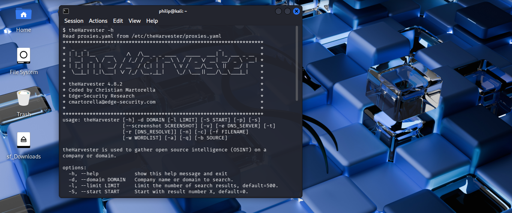
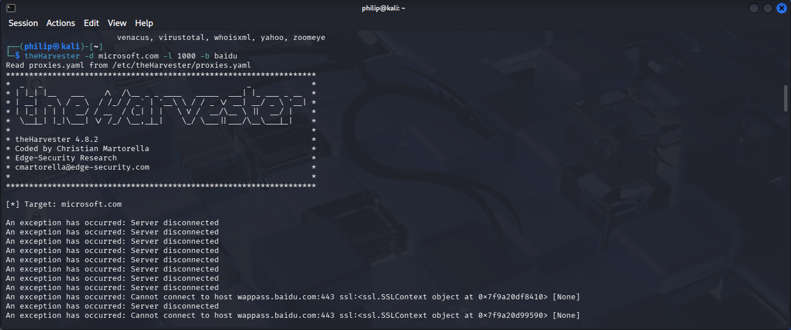
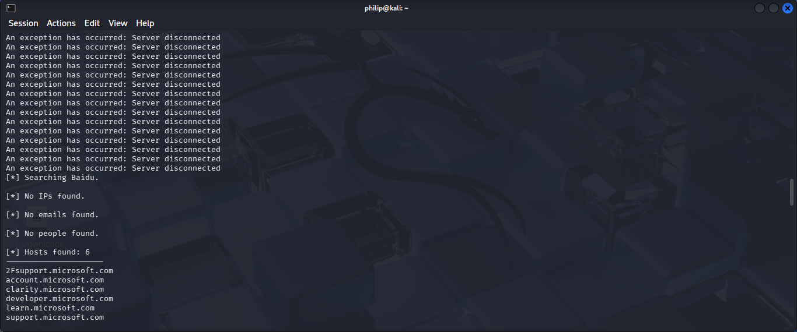
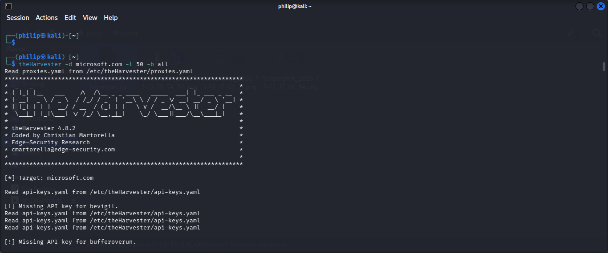
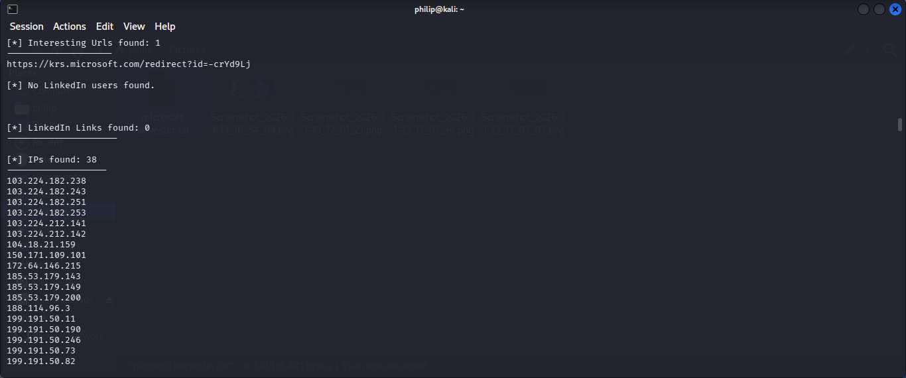

<div align="center">

# 🌾 theHarvester: Searching Public Sources for a Domain's Emails and Sub-domains

**Passive footprinting of `microsoft.com` with theHarvester in Kali Linux, first with Baidu and then with all sources**
</div>

<p align="center">
  
  
  
  
  
</p>

---

## 📌 Project Overview

This is the optional Week 2 lab **W2-PM4: Footprinting & Reconnaissance with theHarvester** from the Networkwalks Cybersecurity internship. theHarvester is an OSINT tool that collects emails, sub-domains, hosts and IP addresses from public sources such as search engines. The lab has two tasks, both against the domain `microsoft.com`, which the lab names as the target:

1. Find email IDs and sub-domains with the **Baidu** source and a limit of **1000** results.
2. Find email IDs and sub-domains with **all sources** and a limit of **50** results.

I ran both in my **Kali Linux VM** on 13 November 2026, with the commands from the lab guide. theHarvester comes with Kali, so no installation was needed. The lab has no automated score or result card, so there is no score here.

My results are different from the lab guide's example. The guide's Baidu run found one email address. **Neither of my runs found any email address**, and the Baidu run was full of connection errors. The guide itself warns that results change because the public sources change. I report what my own runs showed.

| 🔎 Item | ✅ Result |
| ------- | --------- |
| Tool and version | theHarvester 4.8.2 (the lab guide shows 4.10.1) |
| Task 1 command | `theHarvester -d microsoft.com -l 1000 -b baidu` |
| Task 1 result | No emails, no IPs, 6 hosts, with many Baidu connection errors |
| Task 2 command | `theHarvester -d microsoft.com -l 50 -b all` |
| Task 2 result | No emails, 1314 hosts, 38 IPs, 7 ASNs, 1 interesting URL, no LinkedIn users |
| API keys | None configured: 24 sources reported "Missing API key" |

---

## 🎯 Objectives

- Start theHarvester in Kali Linux and read its usage options
- Search one named data source (Baidu) with a result limit
- Search all sources with a smaller limit and compare the two runs
- Read the output: emails, hosts, IPs, ASNs and errors
- Save the output of each run to a text file
- Document what the tool could not do, not only what it found

---

## 🛡️ Why This Matters for Security

theHarvester reads public data about an organization without sending attack traffic to it. Each email address it finds is a possible target for phishing, and each sub-domain is another system an organization has to keep track of. A defender runs the same search on their own domain to see what an outsider could collect, and then reduces it.

My two runs also show a second point: a tool like this depends on its data sources. A source that refuses connections, or one that needs an API key I do not have, changes what I can see. The honest result of an OSINT search is "this is what these sources gave me today".

> ⚠️ **Important:** Only run footprinting against domains you own or have permission to test. The target here was `microsoft.com`, as named by the lab. theHarvester reads third-party public sources, and the commands I ran use no DNS brute force or port scan options, and no API keys were configured. This domain is not covered by my own Networkwalks authorization letter, which names `networkwalks.com` and my own network; I ran it only because the course lab assigns it.

---

## ⚙️ Lab Configuration

| 🧩 Component | ⚙️ Configuration |
| ------------ | ---------------- |
| 🌐 Platform | My own Kali Linux VM, no online lab |
| 🖥️ Analyst PC | Kali Linux |
| 🛠️ Tool | theHarvester 4.8.2 (pre-installed in Kali) |
| 🎯 Target | `microsoft.com` (named by the lab) |
| 🔑 API keys | None configured (`/etc/theHarvester/api-keys.yaml`) |
| 🔒 Privacy | The Kali top panel is cropped from the screenshots; the VM hostname is `kali` |
| 🏆 Scoring | None |

---

# 🪜 Lab Procedure

## Step 1. Open theHarvester and read the options
I opened theHarvester from the Kali menu by searching for it, and then ran its help to read the options.

```bash
theHarvester -h
```

The options I used are `-d` (the domain), `-l` (limit the number of results; the default is 500) and `-b` (the data source).




## Step 2. Task 1: search with Baidu, limit 1000
```bash
theHarvester -d microsoft.com -l 1000 -b baidu
```

The run printed a long list of `An exception has occurred: Server disconnected` lines, with some `Cannot connect to host wappass.baidu.com:443` errors mixed in.



At the end the tool still produced a result: **No IPs found, No emails found, No people found, and Hosts found: 6**. The hosts are `2Fsupport.microsoft.com`, `account.microsoft.com`, `clarity.microsoft.com`, `developer.microsoft.com`, `learn.microsoft.com` and `support.microsoft.com`. The first entry has a stray `2F` in front of it.



**Answer: no email addresses; 6 sub-domains/hosts (the first one malformed). Output saved in [`outputs/task1-baidu-output.txt`](outputs/task1-baidu-output.txt).**

## Step 3. Task 2: search with all sources, limit 50
```bash
theHarvester -d microsoft.com -l 50 -b all
```

At the start the tool reads the API key file and prints a `Missing API key` message for each source that needs one.



My screenshot of the result shows the middle of the output: **1 interesting URL**, **No LinkedIn users found**, **LinkedIn links: 0** and **IPs found: 38**.



Further down, the saved output shows **ASNs found: 7**, **No emails found**, **No people found** and **Hosts found: 1314**. I have no screenshot of this part, so the figures come from my saved text file ([`outputs/task2-all-sources-output.txt`](outputs/task2-all-sources-output.txt)).

**Answer: no email addresses; 1314 hosts (sub-domains), 38 IPs and 7 ASNs.**

---

# 📊 Results

| # | 🎯 Task | ✅ Answer | 🔎 How I Found It |
| - | ------- | --------- | ------------------ |
| 1 | Emails and sub-domains with Baidu, limit 1000 | No emails; 6 hosts | `theHarvester -d microsoft.com -l 1000 -b baidu` |
| 2 | Emails and sub-domains with all sources, limit 50 | No emails; 1314 hosts, 38 IPs, 7 ASNs | `theHarvester -d microsoft.com -l 50 -b all` |

*Footnote: for Task 2 the "No emails found", "ASNs found: 7" and "Hosts found: 1314" lines are not in my screenshots. They come from my saved output file. The lab has no result card, so no score is shown.*

### Timeline (Kali VM clock, 13 November 2026)
| ⏱️ Time | 🔄 What happened |
| ------- | ---------------- |
| 16:53 | Opened theHarvester from the menu |
| 16:54 | Read the help options |
| 17:01 | Task 1 (Baidu) run and result |
| 17:07 | Task 2 (all sources) run |

---

# 🔭 Observations Beyond the Task Questions

These are things I noticed in my screenshots and saved output while documenting. The lab does not ask for them.

1. **My results are different from the lab guide's.** The guide's Baidu run found one email address and no hosts; mine found no emails and 6 hosts. The guide shows version 4.10.1 and my Kali has 4.8.2. The guide warns that results vary because the data sources change.
2. **Baidu failed in both runs.** In Task 1 almost the whole output is connection errors (90 "Server disconnected" lines and 7 "Cannot connect to host wappass.baidu.com" lines in my saved file). In Task 2 Baidu also logged a connection error. I cannot tell from the output why Baidu refused the connections.
3. **The "all" run searched only part of the sources.** My saved output has 16 "Searching" lines, while 24 different sources reported a missing API key. The lab guide's own Task 2 screenshot also shows missing key messages, so this is expected without keys.
4. **Task 2 had several tool errors besides the keys.** The saved output shows a BuiltWith JSON error, a 522 response from the ThreatMiner service, a HaveIBeenPwned error, a missing temporary file in the API endpoints scan and a SecurityScorecard error. The tool kept going each time.
5. **A bigger limit did not give more.** Task 1 used a limit of 1000 and found 6 hosts; Task 2 used a limit of 50 and found 1314. The number of results depends on the source far more than on the limit.
6. **The host list in my saved output pairs each name with an IP address.** I did not check these addresses.
7. **Many host names are descriptive.** In my saved file, 48 of the 1314 host names contain "corp" and 25 contain "teams". This shows how much of an organization's naming can be learned from public sources alone. I did not test any of these hosts.
8. **The `2Fsupport.microsoft.com` entry looks like a parsing leftover.** It looks like a URL-encoded slash stuck to the host name. I cannot confirm that from the output.

---

# 🐞 Challenges Encountered

* **Issue (Task 1, Baidu errors):** The Baidu run produced mostly `Server disconnected` and `Cannot connect to host wappass.baidu.com` errors, and found no emails.
  **Resolution:** I saved the output and reported the result as it was. My files show one Baidu run, with no proxy or other settings changed in the command.
  **What I'll do differently:** Run a second source for the same domain to compare, and repeat a failing run later; the sources behind the tool change over time.

* **Issue (Task 2, no API keys):** Without keys, 24 sources could not be used, so the "all" search covered only part of what the tool supports. Several sources also returned errors.
  **Resolution:** I kept the output and listed the limit in this write-up.
  **What I'll do differently:** Get free API keys for a few sources before running an "all" search, and write down which sources were used.

* **Different results from the lab guide:** I found no email address, where the guide's example found one. This is not a mistake on my side. The guide says results can be different, and my output shows the sources failing.

* **No other blockers.** The tool started and ran as the lab describes, and I saved both outputs.

---

# 💡 Key Learnings

1. A passive footprinting tool depends entirely on its data sources. When a source fails, the answer is incomplete, not "nothing exists".
2. "No emails found" is a result, and it needs context: which sources worked, which failed and why.
3. API keys decide how much theHarvester can do. Without any, 24 sources in my run were unusable.
4. The result limit (`-l`) is only a cap. The source decides how much comes back.
5. Version differences matter. My Kali has 4.8.2 and the lab guide uses 4.10.1, so I should expect small differences.
6. Even without keys, public sources gave 1314 host names and 38 IPs for one domain. Organizations should know what their names and addresses reveal.
7. I should read the errors in the output, not only the final summary. The errors told me more about the quality of my results than the totals did.
8. The same tool can run against my own domain to see what I leak. Next time I will run it on `networkwalks.com` too, within my authorization.

---

# 🔐 Security & Ethical Use

This work is for education only. The lab named `microsoft.com` as the target, and theHarvester only collected information from public sources; the only commands I ran are the two in this write-up, which do not use DNS brute force or Shodan. Emails and names gathered this way are personal data in many cases, so collect only what a test needs. Do not run footprinting against organizations you do not own or have no written permission to test; this lab's target is covered only by the course's instructions, not by my own authorization letter.

---

# 🔗 Tools & Resources

- **theHarvester:** https://github.com/laramies/theHarvester
- **NetworkWalks:** https://networkwalks.com

---

# 👤 Author
**Philip Ajik**
Cybersecurity Student (Batch B082) — Networkwalks Academy
LinkedIn: https://www.linkedin.com/in/philip-ajik-a22944384

---

## 📌 Project Information
**Program Name:** Cybersecurity at Networkwalks | **Task:** W2-PM4 (optional) | **Project:** Footprinting with theHarvester | **Repository:** GitHub
